# Network Traffic Analysis Using Wireshark

Cybersecurity Project 02 | Network Security | SOC Fundamentals

## Project Overview

This project focuses on analysing network traffic using Wireshark to develop practical skills in network protocol analysis, packet inspection, and security monitoring.

Four public training packet captures were analysed to investigate DNS communication, TCP connection establishment, HTTP requests and responses, and TLS-encrypted traffic.

The project also includes protocol hierarchy analysis, TCP conversation statistics, and IPv4 endpoint analysis.

**Note:** This project uses publicly available training captures. It does not represent live production network monitoring or an investigation of an actual security incident.

## Objectives

- Analyse DNS queries and responses.
- Identify the TCP three-way handshake.
- Examine HTTP GET requests and server responses.
- Understand TLS handshakes and encrypted application data.
- Investigate network protocol distribution.
- Analyse TCP conversations and IPv4 endpoints.
- Document technical findings and supporting evidence.

## Tools and Technologies

- Wireshark
- TCP/IP
- DNS
- TCP and UDP
- HTTP/HTTPS
- TLS 1.2
- PCAP/PCAPNG Analysis
- Network Traffic Analysis

## Datasets

| Capture File | Purpose |
|---|---|
| `dns.cap` | DNS query and response analysis |
| `3-way-handshake.pcap` | TCP three-way handshake |
| `http.cap` | HTTP request and response analysis |
| `dump.pcapng` | TLS handshake and network statistics |

Capture files were obtained from Wireshark's public sample resources.

See [Capture Sources](captures/README.md).

## Investigation 01 – DNS Traffic Analysis

The DNS capture was analysed to identify DNS queries and responses.

### Findings

- Client IP: `192.168.170.8`
- DNS Server IP: `192.168.170.20`
- Domain: `google.com`
- Query Type: TXT
- Transaction ID: `0x1032`
- Response Code: No error
- Answer Records: 1
- Response Time: 0.53 milliseconds

The DNS request and response were correlated using their transaction ID.

### Evidence

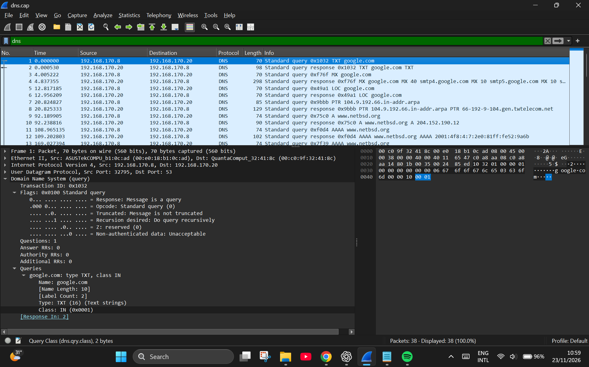

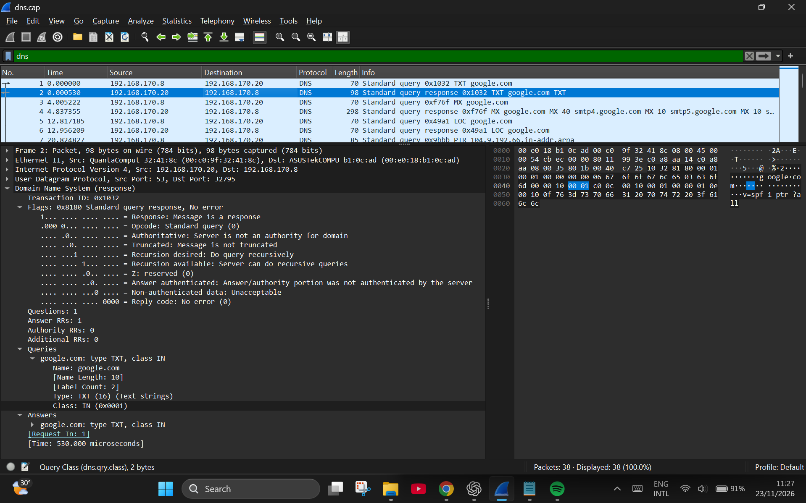

## Investigation 02 – TCP Three-Way Handshake

A TCP connection establishment process was examined.

| Packet | TCP Flags | Relative Seq | Relative Ack |
|---|---|---|---|
| 1 | SYN | 0 | 0 (ACK not set) |
| 2 | SYN, ACK | 0 | 1 |
| 3 | ACK | 1 | 1 |

### Findings

- Client: `192.168.1.104:49859`
- Server: `216.18.166.136:80`
- The TCP three-way handshake was successfully completed.

### Evidence

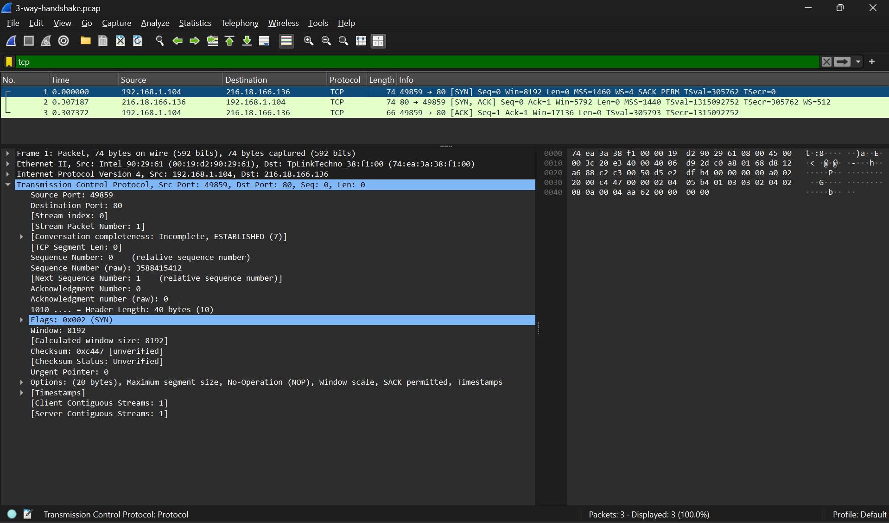

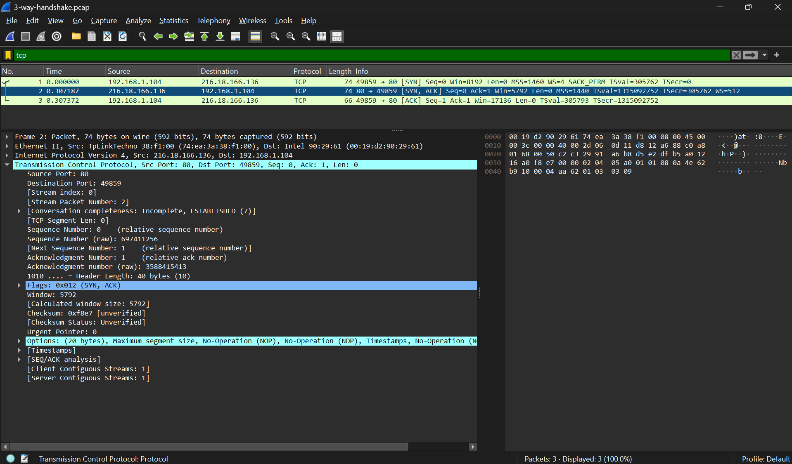

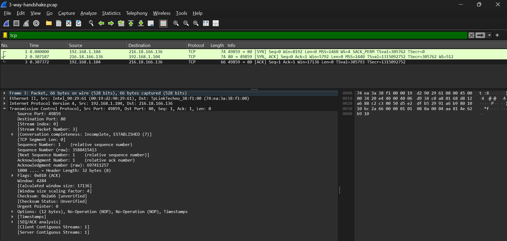

## Investigation 03 – HTTP Traffic Analysis

HTTP request and response packets were investigated.

### HTTP Request

- Packet: 4
- Method: GET
- Resource: `/download.html`
- Host: `www.ethereal.com`
- Version: HTTP/1.1

### HTTP Response

- Packet: 38
- Status: `200 OK`
- Server: Apache
- Content-Type: `text/html`
- Content-Length: 18,070 bytes
- Time Since Request: 3.935659 seconds

### Security Observation

HTTP traffic was readable because it was transmitted without TLS encryption. HTTPS should be used to protect sensitive web communications.

### Evidence

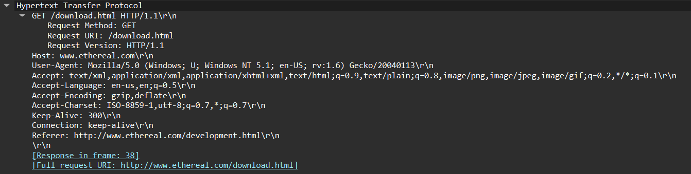

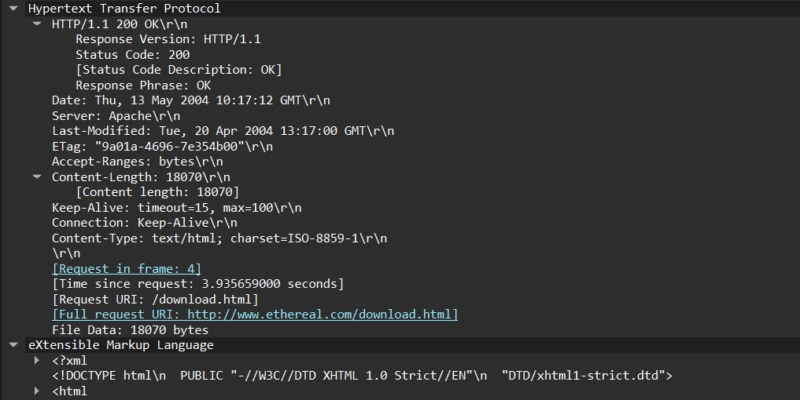

## Investigation 04 – TLS Traffic Analysis

TLS 1.2 handshake messages and encrypted application data were analysed.

| Packet | Observation |
|---|---|
| 19 | TLS Client Hello |
| 21 | TLS Server Hello |
| 25 | Encrypted TLS Application Data |

All three investigated packets belonged to TCP Stream 1.

### Findings

- TLS Version: TLS 1.2
- Client offered two cipher suites.
- Selected Cipher Suite: `TLS_ECDHE_ECDSA_WITH_AES_256_GCM_SHA384`
- Selected Compression Method: DEFLATE
- TLS application data was not directly readable without decryption keys.

### Security Observation

The training capture demonstrated encrypted application data and a legacy TLS compression configuration. Modern TLS deployments should avoid TLS-level compression.

### Evidence

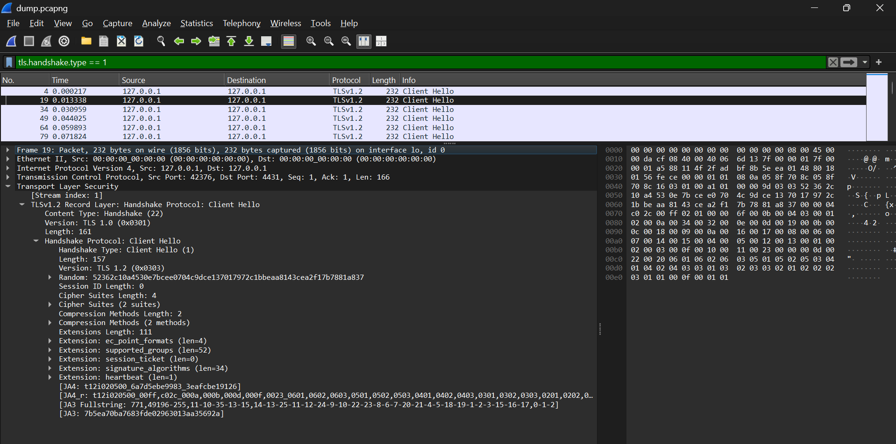

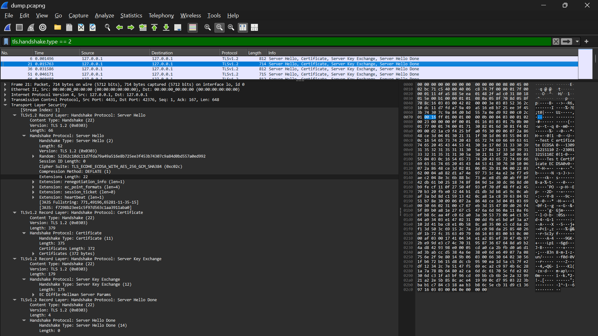

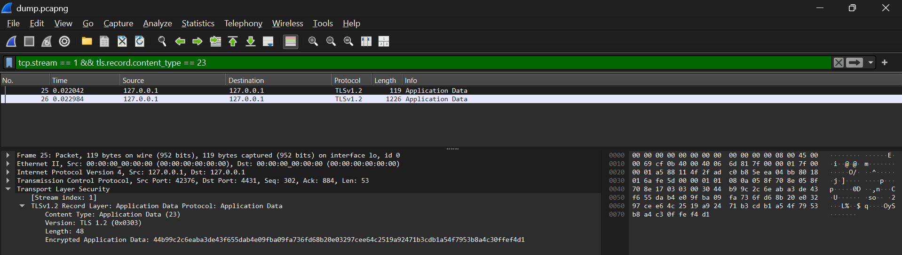

## Investigation 05 – Network Traffic Statistics

### Protocol Hierarchy

The `dump.pcapng` capture contained 1,095 packets and 264,206 bytes.

| Protocol | Packets | Percentage |
|---|---|---|
| Ethernet | 1,095 | 100% |
| IPv4 | 1,095 | 100% |
| TCP | 1,095 | 100% |
| TLS | 511 | 46.7% |

TLS accounted for approximately 72.5% of captured bytes.

Protocol hierarchy categories overlap because a packet can contain multiple protocol layers.

### TCP Conversations

- Total TCP Conversations: 73
- Loopback Address: `127.0.0.1`
- Investigated TCP Stream: 1
- Packets in Stream 1: 15

### IPv4 Endpoints

- Unique IPv4 Endpoints: 1
- Endpoint Address: `127.0.0.1`
- Actual Captured Packets: 1,095
- Combined Transmitted/Received Endpoint Counts: 2,190

The combined endpoint count reflects loopback traffic counted in both directions, not 2,190 unique captured packets.

### Evidence

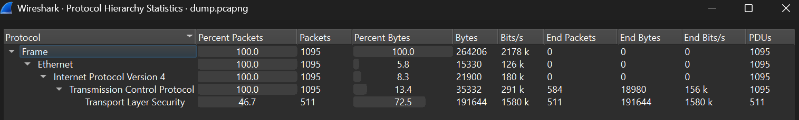

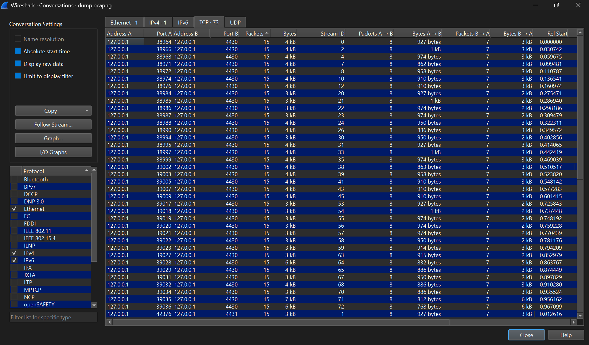

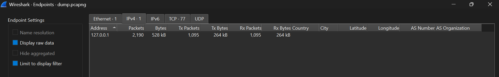

## Security Recommendations

1. Prefer HTTPS with modern TLS configurations.
2. Disable legacy TLS-level compression.
3. Monitor unexpected network connections and protocol behaviour.
4. Correlate network traffic with endpoint and security logs.
5. Maintain investigation documentation and evidence.
6. Avoid identifying malicious activity based only on packet volume.

## Investigation Conclusion

This project provided practical experience in packet inspection, DNS analysis, TCP connection establishment, HTTP communication, TLS encryption, and network traffic statistics.

No confirmed malicious activity was identified from the reviewed training captures.

The project strengthened foundational skills relevant to cybersecurity, SOC monitoring, and network security.

## Final Investigation Report

[View Full Investigation Report (PDF)](reports/SOC_Project_02_Wireshark_Network_Traffic_Analysis_Report.pdf)

## References

- [Wireshark User's Guide](https://www.wireshark.org/docs/wsug_html/)
- [Wireshark Sample Captures](https://wiki.wireshark.org/SampleCaptures)
- [Wireshark TLS Documentation](https://wiki.wireshark.org/TLS/)
- [Wireshark HTTP Documentation](https://wiki.wireshark.org/Hyper_Text_Transfer_Protocol)
- [Wireshark Display Filter Reference](https://www.wireshark.org/docs/dfref/)
